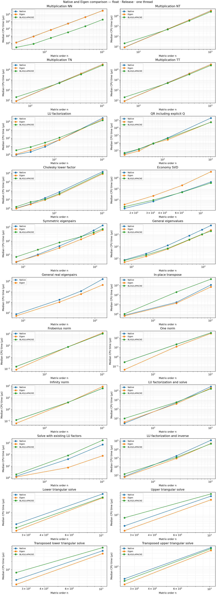
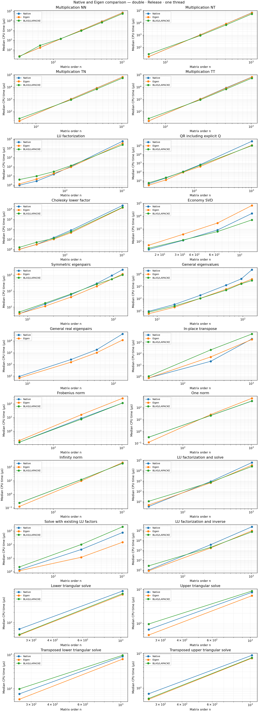

# Eigen comparison benchmark — 2026-10-23

Published artifacts include final CSV summaries, charts, and metadata. Raw benchmark JSON, run indexes, diagnostic logs, and intermediate measurements are generated locally and excluded from version control.

Model Name: MacBook Pro; Chip: Apple M4 Pro; Total Number of Cores: 14 (10 Performance and 4 Efficiency); Memory: 24 GB

Release; SIMD=ON; ISA=neon; C++17; LTO=off. All backends use one thread. Cases run sequentially with three repetitions, at least 0.1 seconds per repetition. Timings are median CPU microseconds.

**Tests:** 99 GoogleTest cases passed. See `tests.log` and `tests-detail.log.gz`.

**Benchmarks:** 556/556 cases succeeded; 0 incomplete. 188 operation/scalar/shape combinations.

Native / Eigen is native time divided by Eigen time; values above 1 favor Eigen. A dash means no result was registered. BLAS/LAPACKE identifies the configured vendor library; norms use the shared CPU implementation for each CPU backend.

## Largest registered cases

### float

| Operation | Shape | Native µs | Eigen µs | BLAS/LAPACKE µs | Native / Eigen |
|---|---|---|---|---|---|
| Multiplication NN | 1024/1024/1024 | 33874.000 | 33542.000 | 1899.171 | 1.010 |
| Multiplication NT | 1024 | 34655.000 | 33449.250 | 27239.000 | 1.036 |
| Multiplication TN | 1024 | 33923.000 | 33234.250 | 27310.400 | 1.021 |
| Multiplication TT | 1024 | 33962.500 | 33620.500 | 27111.800 | 1.010 |
| LU factorization | 1024 | 27743.800 | 19885.714 | 14841.222 | 1.395 |
| QR including explicit Q | 1024 | 205042.000 | 59310.500 | 57564.000 | 3.457 |
| Cholesky lower factor | 1024 | 14768.400 | 8333.412 | 10390.846 | 1.772 |
| Economy SVD | 128 | 4371.656 | 37419.750 | 3530.487 | 0.117 |
| Symmetric eigenpairs | 128 | 1358.369 | 630.350 | 743.358 | 2.155 |
| General eigenvalues | 128 | 5867.625 | 2408.322 | 1962.408 | 2.436 |
| General real eigenpairs | 128 | 15956.778 | 4565.484 | — | 3.495 |
| In-place transpose | 1024/1024 | 1129.320 | 708.071 | 4553.194 | 1.595 |
| Frobenius norm | 1024 | 108.268 | 126.722 | 107.634 | 0.854 |
| One norm | 1024 | 347.473 | 302.961 | 348.005 | 1.147 |
| Infinity norm | 1024 | 63.727 | 90.280 | 63.941 | 0.706 |
| LU factorization and solve | 1024 | 28482.000 | 19847.429 | 16463.500 | 1.435 |
| Solve with existing LU factors | 1024 | 721.804 | 79.042 | 1717.633 | 9.132 |
| LU factorization and inverse | 1024 | 121077.000 | 50748.667 | 47499.667 | 2.386 |
| Lower triangular solve | 1024/16 | 450.485 | 328.358 | 341.601 | 1.372 |
| Upper triangular solve | 1024/16 | 464.302 | 344.740 | 556.611 | 1.347 |
| Transposed lower triangular solve | 1024/16 | 495.053 | 391.803 | 648.390 | 1.264 |
| Transposed upper triangular solve | 1024/16 | 476.414 | 382.642 | 439.433 | 1.245 |

### double

| Operation | Shape | Native µs | Eigen µs | BLAS/LAPACKE µs | Native / Eigen |
|---|---|---|---|---|---|
| Multiplication NN | 1024/1024/1024 | 68056.500 | 66890.500 | 54421.333 | 1.017 |
| Multiplication NT | 1024 | 68048.500 | 65844.000 | 54266.333 | 1.033 |
| Multiplication TN | 1024 | 67813.000 | 66852.500 | 55007.000 | 1.014 |
| Multiplication TT | 1024 | 67946.500 | 65941.000 | 54369.333 | 1.030 |
| LU factorization | 1024 | 58650.500 | 34849.250 | 24078.000 | 1.683 |
| QR including explicit Q | 1024 | 329609.000 | 116402.000 | 103972.000 | 2.832 |
| Cholesky lower factor | 1024 | 25247.400 | 15144.111 | 16261.500 | 1.667 |
| Economy SVD | 128 | 16110.000 | 67967.000 | 5033.393 | 0.237 |
| Symmetric eigenpairs | 128 | 2127.833 | 1147.295 | 1013.423 | 1.855 |
| General eigenvalues | 128 | 23151.000 | 3996.571 | 3048.304 | 5.793 |
| General real eigenpairs | 128 | 39189.750 | 11984.636 | — | 3.270 |
| In-place transpose | 1024/1024 | 1988.380 | 1785.605 | 5355.654 | 1.114 |
| Frobenius norm | 1024 | 113.814 | 254.350 | 115.011 | 0.447 |
| One norm | 1024 | 359.582 | 619.702 | 366.676 | 0.580 |
| Infinity norm | 1024 | 186.720 | 214.311 | 186.059 | 0.871 |
| LU factorization and solve | 1024 | 62466.500 | 34798.250 | 26122.800 | 1.795 |
| Solve with existing LU factors | 1024 | 768.489 | 148.731 | 2039.697 | 5.167 |
| LU factorization and inverse | 1024 | 245935.000 | 97471.000 | 75882.500 | 2.523 |
| Lower triangular solve | 1024/16 | 822.811 | 650.158 | 690.020 | 1.266 |
| Upper triangular solve | 1024/16 | 827.887 | 656.272 | 901.363 | 1.261 |
| Transposed lower triangular solve | 1024/16 | 902.884 | 751.462 | 975.538 | 1.202 |
| Transposed upper triangular solve | 1024/16 | 896.301 | 739.814 | 761.071 | 1.212 |

## Native changes versus baseline

Baseline: the original six-kernel measurements, plus the initial norm measurements and transpose measurements using the preserved original library. Speedup is baseline time divided by current time. The baseline values are included in `improvements.csv`; build details are in `metadata.json`. Full results: [improvements.csv](improvements.csv).

| Operation | Scalar | Shape | Before µs | After µs | Speedup |
|---|---|---|---:|---:|---:|
| Multiplication NN | float | 1024/1024/1024 | 36922.500 | 33874.000 | 1.09× |
| Multiplication NN | double | 1024/1024/1024 | 70875.500 | 68056.500 | 1.04× |
| Multiplication NT | float | 1024 | 36556.000 | 34655.000 | 1.05× |
| Multiplication NT | double | 1024 | 71521.000 | 68048.500 | 1.05× |
| Multiplication TN | float | 1024 | 36847.000 | 33923.000 | 1.09× |
| Multiplication TN | double | 1024 | 70797.500 | 67813.000 | 1.04× |
| Multiplication TT | float | 1024 | 36656.500 | 33962.500 | 1.08× |
| Multiplication TT | double | 1024 | 70921.500 | 67946.500 | 1.04× |
| LU factorization | float | 1024 | 27847.600 | 27743.800 | 1.00× |
| LU factorization | double | 1024 | 58171.500 | 58650.500 | 0.99× |
| QR including explicit Q | float | 1024 | 178480.000 | 205042.000 | 0.87× |
| QR including explicit Q | double | 1024 | 327376.000 | 329609.000 | 0.99× |
| Cholesky lower factor | float | 1024 | 18887.143 | 14768.400 | 1.28× |
| Cholesky lower factor | double | 1024 | 40290.000 | 25247.400 | 1.60× |
| Economy SVD | float | 128 | 4304.594 | 4371.656 | 0.98× |
| Economy SVD | double | 128 | 15961.222 | 16110.000 | 0.99× |
| Symmetric eigenpairs | float | 128 | 8026.941 | 1358.369 | 5.91× |
| Symmetric eigenpairs | double | 128 | 12424.364 | 2127.833 | 5.84× |
| General eigenvalues | float | 128 | 32036.250 | 5867.625 | 5.46× |
| General eigenvalues | double | 128 | 85448.000 | 23151.000 | 3.69× |
| General real eigenpairs | float | 128 | 62287.000 | 15956.778 | 3.90× |
| General real eigenpairs | double | 128 | 102872.000 | 39189.750 | 2.62× |
| In-place transpose | float | 1024/1024 | 2082.059 | 1129.320 | 1.84× |
| In-place transpose | double | 1024/1024 | 4180.794 | 1988.380 | 2.10× |
| Frobenius norm | float | 1024 | 802.822 | 108.268 | 7.42× |
| Frobenius norm | double | 1024 | 1281.426 | 113.814 | 11.26× |
| One norm | float | 1024 | 1217.086 | 347.473 | 3.50× |
| One norm | double | 1024 | 1266.911 | 359.582 | 3.52× |
| Infinity norm | float | 1024 | 674.077 | 63.727 | 10.58× |
| Infinity norm | double | 1024 | 688.240 | 186.720 | 3.69× |

## Scaling

Square inputs; triangular solves fix the number of right-hand sides at 16.

## Measurement details

- Compiler: `Apple clang version 21.0.0 (clang-2100.3.34.2)`.
- Configuration, source hashes, timestamps, and thread settings: [metadata.json](metadata.json).
- All timings and variation: [timings.csv](timings.csv); aligned results: [comparison.csv](comparison.csv).
- Commands and outcomes: `runs.json`; original JSON and logs: `raw/`.
- Measurement phases and source snapshots are recorded in metadata. When cases are repeated after a final change, their earlier measurements remain in `first-pass/`.
- Native LU pivoting: OFF. Eigen LU uses partial pivoting. The common diagonally dominant input avoids swaps.
- QR includes explicit Q formation. SVD includes thin U and row-major VT; algorithms differ by backend.
- Input refresh is untimed except for SVD. Outputs and workspaces are preallocated; internal backend allocations and copies remain timed.
- Factorized solves exclude LU factorization for every backend. Linear solve and inversion include factorization.
- Triangular solves include copying the right-hand side and use a non-unit diagonal. Transpose is in place for every backend.
- General eigenpairs use a real-spectrum input distinct from eigenvalues-only cases.
- Native SVD registrations stop at 128. Results describe these inputs on this host; scheduling and thermal state can affect them.

## All measurements

### Multiplication NN

| Scalar / shape | Native µs | Eigen µs | BLAS/LAPACKE µs | Native / Eigen |
|---|---|---|---|---|
| double / 32/32/32 | 2.206 | 2.173 | 1.968 | 1.015 |
| double / 64/64/64 | 17.061 | 16.763 | 28.351 | 1.018 |
| double / 64/1024/256 | 1124.484 | 1106.677 | 978.678 | 1.016 |
| double / 128/128/128 | 135.908 | 135.127 | 138.305 | 1.006 |
| double / 256/256/256 | 1064.466 | 1049.586 | 922.397 | 1.014 |
| double / 512/512/512 | 8543.813 | 8268.824 | 6795.200 | 1.033 |
| double / 1024/64/256 | 1100.969 | 1082.426 | 1107.722 | 1.017 |
| double / 1024/1024/1024 | 68056.500 | 66890.500 | 54421.333 | 1.017 |
| float / 32/32/32 | 1.200 | 1.159 | 0.253 | 1.035 |
| float / 64/64/64 | 8.753 | 8.437 | 0.774 | 1.037 |
| float / 64/1024/256 | 562.996 | 549.642 | 34.963 | 1.024 |
| float / 128/128/128 | 68.556 | 70.146 | 5.216 | 0.977 |
| float / 256/256/256 | 535.773 | 518.507 | 32.038 | 1.033 |
| float / 512/512/512 | 4195.939 | 4154.735 | 222.810 | 1.010 |
| float / 1024/64/256 | 588.734 | 536.019 | 41.190 | 1.098 |
| float / 1024/1024/1024 | 33874.000 | 33542.000 | 1899.171 | 1.010 |

### Multiplication NT

| Scalar / shape | Native µs | Eigen µs | BLAS/LAPACKE µs | Native / Eigen |
|---|---|---|---|---|
| double / 64 | 16.959 | 16.868 | 27.590 | 1.005 |
| double / 256 | 1059.947 | 1041.746 | 913.503 | 1.017 |
| double / 512 | 8435.235 | 8317.471 | 6763.143 | 1.014 |
| double / 1024 | 68048.500 | 65844.000 | 54266.333 | 1.033 |
| float / 64 | 8.779 | 8.383 | 20.850 | 1.047 |
| float / 256 | 535.370 | 521.736 | 487.592 | 1.026 |
| float / 512 | 4192.667 | 4136.765 | 3534.650 | 1.014 |
| float / 1024 | 34655.000 | 33449.250 | 27239.000 | 1.036 |

### Multiplication TN

| Scalar / shape | Native µs | Eigen µs | BLAS/LAPACKE µs | Native / Eigen |
|---|---|---|---|---|
| double / 64 | 17.405 | 17.273 | 27.023 | 1.008 |
| double / 256 | 1071.344 | 1053.884 | 913.461 | 1.017 |
| double / 512 | 8540.563 | 8294.471 | 6937.850 | 1.030 |
| double / 1024 | 67813.000 | 66852.500 | 55007.000 | 1.014 |
| float / 64 | 8.618 | 8.416 | 20.507 | 1.024 |
| float / 256 | 548.469 | 521.558 | 491.753 | 1.052 |
| float / 512 | 4264.758 | 4190.364 | 3556.000 | 1.018 |
| float / 1024 | 33923.000 | 33234.250 | 27310.400 | 1.021 |

### Multiplication TT

| Scalar / shape | Native µs | Eigen µs | BLAS/LAPACKE µs | Native / Eigen |
|---|---|---|---|---|
| double / 64 | 17.272 | 17.406 | 27.269 | 0.992 |
| double / 256 | 1068.763 | 1046.135 | 918.699 | 1.022 |
| double / 512 | 8820.500 | 8285.706 | 6925.190 | 1.065 |
| double / 1024 | 67946.500 | 65941.000 | 54369.333 | 1.030 |
| float / 64 | 8.676 | 8.546 | 20.342 | 1.015 |
| float / 256 | 545.695 | 521.390 | 488.647 | 1.047 |
| float / 512 | 4274.939 | 4177.939 | 3511.875 | 1.023 |
| float / 1024 | 33962.500 | 33620.500 | 27111.800 | 1.010 |

### LU factorization

| Scalar / shape | Native µs | Eigen µs | BLAS/LAPACKE µs | Native / Eigen |
|---|---|---|---|---|
| double / 16 | 0.960 | 1.293 | 3.919 | 0.742 |
| double / 32 | 2.650 | 4.373 | 9.493 | 0.606 |
| double / 64 | 14.555 | 18.186 | 28.531 | 0.800 |
| double / 128 | 105.365 | 90.736 | 129.502 | 1.161 |
| double / 1024 | 58650.500 | 34849.250 | 24078.000 | 1.683 |
| float / 16 | 0.978 | 1.171 | 3.442 | 0.835 |
| float / 32 | 2.173 | 3.631 | 8.569 | 0.598 |
| float / 64 | 9.097 | 14.017 | 28.904 | 0.649 |
| float / 128 | 62.797 | 63.346 | 115.643 | 0.991 |
| float / 1024 | 27743.800 | 19885.714 | 14841.222 | 1.395 |

### QR including explicit Q

| Scalar / shape | Native µs | Eigen µs | BLAS/LAPACKE µs | Native / Eigen |
|---|---|---|---|---|
| double / 16 | 4.329 | 3.038 | 5.621 | 1.425 |
| double / 32 | 20.519 | 12.329 | 22.169 | 1.664 |
| double / 64 | 108.636 | 91.460 | 103.285 | 1.188 |
| double / 128 | 694.784 | 427.165 | 590.694 | 1.626 |
| double / 1024 | 329609.000 | 116402.000 | 103972.000 | 2.832 |
| float / 16 | 3.634 | 2.695 | 4.905 | 1.349 |
| float / 32 | 14.868 | 8.957 | 15.525 | 1.660 |
| float / 64 | 78.386 | 88.063 | 88.685 | 0.890 |
| float / 128 | 473.231 | 277.452 | 409.145 | 1.706 |
| float / 1024 | 205042.000 | 59310.500 | 57564.000 | 3.457 |

### Cholesky lower factor

| Scalar / shape | Native µs | Eigen µs | BLAS/LAPACKE µs | Native / Eigen |
|---|---|---|---|---|
| double / 16 | 1.028 | 0.990 | 1.611 | 1.038 |
| double / 32 | 3.169 | 3.117 | 5.198 | 1.016 |
| double / 64 | 15.204 | 10.817 | 12.658 | 1.406 |
| double / 128 | 82.583 | 46.478 | 59.729 | 1.777 |
| double / 1024 | 25247.400 | 15144.111 | 16261.500 | 1.667 |
| float / 16 | 1.060 | 0.990 | 1.554 | 1.071 |
| float / 32 | 3.219 | 2.930 | 5.350 | 1.099 |
| float / 64 | 15.424 | 9.447 | 10.970 | 1.633 |
| float / 128 | 75.220 | 38.635 | 48.098 | 1.947 |
| float / 1024 | 14768.400 | 8333.412 | 10390.846 | 1.772 |

### Economy SVD

| Scalar / shape | Native µs | Eigen µs | BLAS/LAPACKE µs | Native / Eigen |
|---|---|---|---|---|
| double / 16 | 23.941 | 51.443 | 30.029 | 0.465 |
| double / 32 | 124.618 | 372.411 | 132.372 | 0.335 |
| double / 64 | 804.655 | 2848.327 | 605.108 | 0.283 |
| double / 128 | 16110.000 | 67967.000 | 5033.393 | 0.237 |
| float / 16 | 16.611 | 38.369 | 24.086 | 0.433 |
| float / 32 | 74.007 | 237.907 | 97.070 | 0.311 |
| float / 64 | 536.202 | 2146.909 | 504.369 | 0.250 |
| float / 128 | 4371.656 | 37419.750 | 3530.487 | 0.117 |

### Symmetric eigenpairs

| Scalar / shape | Native µs | Eigen µs | BLAS/LAPACKE µs | Native / Eigen |
|---|---|---|---|---|
| double / 8 | 3.891 | 3.927 | 4.947 | 0.991 |
| double / 16 | 15.481 | 11.527 | 17.814 | 1.343 |
| double / 32 | 59.818 | 42.185 | 65.573 | 1.418 |
| double / 64 | 297.140 | 198.939 | 267.197 | 1.494 |
| double / 96 | 926.039 | 556.164 | 550.996 | 1.665 |
| double / 128 | 2127.833 | 1147.295 | 1013.423 | 1.855 |
| float / 8 | 2.890 | 3.105 | 6.992 | 0.931 |
| float / 16 | 10.353 | 8.956 | 23.194 | 1.156 |
| float / 32 | 43.270 | 31.396 | 78.421 | 1.378 |
| float / 64 | 204.756 | 132.466 | 206.956 | 1.546 |
| float / 96 | 592.948 | 319.945 | 417.426 | 1.853 |
| float / 128 | 1358.369 | 630.350 | 743.358 | 2.155 |

### General eigenvalues

| Scalar / shape | Native µs | Eigen µs | BLAS/LAPACKE µs | Native / Eigen |
|---|---|---|---|---|
| double / 8 | 9.583 | 6.066 | 8.229 | 1.580 |
| double / 16 | 34.539 | 20.439 | 25.747 | 1.690 |
| double / 32 | 193.044 | 108.887 | 107.857 | 1.773 |
| double / 64 | 1276.400 | 604.004 | 504.801 | 2.113 |
| double / 96 | 4150.471 | 1809.617 | 1657.333 | 2.294 |
| double / 128 | 23151.000 | 3996.571 | 3048.304 | 5.793 |
| float / 8 | 7.740 | 5.031 | 7.081 | 1.538 |
| float / 16 | 25.913 | 15.319 | 20.075 | 1.692 |
| float / 32 | 125.995 | 62.982 | 70.803 | 2.000 |
| float / 64 | 828.375 | 365.477 | 390.811 | 2.267 |
| float / 96 | 2548.673 | 1024.023 | 1074.429 | 2.489 |
| float / 128 | 5867.625 | 2408.322 | 1962.408 | 2.436 |

### General real eigenpairs

| Scalar / shape | Native µs | Eigen µs | BLAS/LAPACKE µs | Native / Eigen |
|---|---|---|---|---|
| double / 8 | 9.229 | 6.770 | — | 1.363 |
| double / 32 | 255.038 | 152.202 | — | 1.676 |
| double / 64 | 1788.333 | 988.563 | — | 1.809 |
| double / 128 | 39189.750 | 11984.636 | — | 3.270 |
| float / 8 | 7.528 | 5.224 | — | 1.441 |
| float / 32 | 179.237 | 106.137 | — | 1.689 |
| float / 64 | 1170.941 | 618.946 | — | 1.892 |
| float / 128 | 15956.778 | 4565.484 | — | 3.495 |

### In-place transpose

| Scalar / shape | Native µs | Eigen µs | BLAS/LAPACKE µs | Native / Eigen |
|---|---|---|---|---|
| double / 32/32 | 0.767 | 0.761 | 1.068 | 1.008 |
| double / 64/256 | 32.502 | 11.329 | 32.556 | 2.869 |
| double / 256/64 | 32.237 | 11.681 | 17.378 | 2.760 |
| double / 256/256 | 21.842 | 52.623 | 217.977 | 0.415 |
| double / 1024/1024 | 1988.380 | 1785.605 | 5355.654 | 1.114 |
| float / 32/32 | 0.760 | 0.653 | 1.048 | 1.164 |
| float / 64/256 | 31.714 | 9.077 | 12.495 | 3.494 |
| float / 256/64 | 31.729 | 9.673 | 9.706 | 3.280 |
| float / 256/256 | 17.188 | 13.809 | 201.331 | 1.245 |
| float / 1024/1024 | 1129.320 | 708.071 | 4553.194 | 1.595 |

### Frobenius norm

| Scalar / shape | Native µs | Eigen µs | BLAS/LAPACKE µs | Native / Eigen |
|---|---|---|---|---|
| double / 32 | 0.154 | 0.204 | 0.154 | 0.753 |
| double / 256 | 8.763 | 15.899 | 7.499 | 0.551 |
| double / 1024 | 113.814 | 254.350 | 115.011 | 0.447 |
| float / 32 | 0.159 | 0.087 | 0.160 | 1.833 |
| float / 256 | 7.754 | 7.882 | 7.797 | 0.984 |
| float / 1024 | 108.268 | 126.722 | 107.634 | 0.854 |

### One norm

| Scalar / shape | Native µs | Eigen µs | BLAS/LAPACKE µs | Native / Eigen |
|---|---|---|---|---|
| double / 32 | 0.326 | 0.123 | 0.327 | 2.648 |
| double / 256 | 21.799 | 26.253 | 21.787 | 0.830 |
| double / 1024 | 359.582 | 619.702 | 366.676 | 0.580 |
| float / 32 | 0.287 | 0.047 | 0.287 | 6.062 |
| float / 256 | 21.234 | 12.359 | 21.466 | 1.718 |
| float / 1024 | 347.473 | 302.961 | 348.005 | 1.147 |

### Infinity norm

| Scalar / shape | Native µs | Eigen µs | BLAS/LAPACKE µs | Native / Eigen |
|---|---|---|---|---|
| double / 32 | 0.227 | 0.125 | 0.228 | 1.823 |
| double / 256 | 11.870 | 9.531 | 11.888 | 1.245 |
| double / 1024 | 186.720 | 214.311 | 186.059 | 0.871 |
| float / 32 | 0.128 | 0.067 | 0.127 | 1.914 |
| float / 256 | 4.023 | 3.919 | 4.030 | 1.027 |
| float / 1024 | 63.727 | 90.280 | 63.941 | 0.706 |

### LU factorization and solve

| Scalar / shape | Native µs | Eigen µs | BLAS/LAPACKE µs | Native / Eigen |
|---|---|---|---|---|
| double / 32 | 3.439 | 4.772 | 11.086 | 0.721 |
| double / 256 | 913.480 | 682.985 | 762.790 | 1.337 |
| double / 1024 | 62466.500 | 34798.250 | 26122.800 | 1.795 |
| float / 32 | 3.016 | 4.138 | 10.137 | 0.729 |
| float / 256 | 499.269 | 395.431 | 577.622 | 1.263 |
| float / 1024 | 28482.000 | 19847.429 | 16463.500 | 1.435 |

### Solve with existing LU factors

| Scalar / shape | Native µs | Eigen µs | BLAS/LAPACKE µs | Native / Eigen |
|---|---|---|---|---|
| double / 32 | 1.375 | 1.166 | 2.212 | 1.179 |
| double / 256 | 43.241 | 11.523 | 100.836 | 3.753 |
| double / 1024 | 768.489 | 148.731 | 2039.697 | 5.167 |
| float / 32 | 1.358 | 1.173 | 1.966 | 1.158 |
| float / 256 | 40.542 | 7.687 | 83.816 | 5.274 |
| float / 1024 | 721.804 | 79.042 | 1717.633 | 9.132 |

### LU factorization and inverse

| Scalar / shape | Native µs | Eigen µs | BLAS/LAPACKE µs | Native / Eigen |
|---|---|---|---|---|
| double / 32 | 10.133 | 8.558 | 27.032 | 1.184 |
| double / 256 | 3746.579 | 1752.188 | 2032.212 | 2.138 |
| double / 1024 | 245935.000 | 97471.000 | 75882.500 | 2.523 |
| float / 32 | 7.386 | 6.384 | 14.143 | 1.157 |
| float / 256 | 1843.500 | 924.417 | 1226.342 | 1.994 |
| float / 1024 | 121077.000 | 50748.667 | 47499.667 | 2.386 |

### Lower triangular solve

| Scalar / shape | Native µs | Eigen µs | BLAS/LAPACKE µs | Native / Eigen |
|---|---|---|---|---|
| double / 32/1 | 0.968 | 0.460 | 0.465 | 2.104 |
| double / 256/1 | 20.648 | 17.412 | 17.837 | 1.186 |
| double / 256/16 | 65.841 | 44.346 | 45.862 | 1.485 |
| double / 1024/16 | 822.811 | 650.158 | 690.020 | 1.266 |
| float / 32/1 | 0.933 | 0.395 | 0.477 | 2.363 |
| float / 256/1 | 15.804 | 8.000 | 15.408 | 1.976 |
| float / 256/16 | 39.279 | 23.198 | 29.383 | 1.693 |
| float / 1024/16 | 450.485 | 328.358 | 341.601 | 1.372 |

### Upper triangular solve

| Scalar / shape | Native µs | Eigen µs | BLAS/LAPACKE µs | Native / Eigen |
|---|---|---|---|---|
| double / 32/1 | 0.965 | 0.491 | 0.578 | 1.966 |
| double / 256/1 | 20.470 | 17.541 | 22.815 | 1.167 |
| double / 256/16 | 66.512 | 45.765 | 96.762 | 1.453 |
| double / 1024/16 | 827.887 | 656.272 | 901.363 | 1.261 |
| float / 32/1 | 0.944 | 0.466 | 0.617 | 2.027 |
| float / 256/1 | 19.311 | 9.060 | 20.968 | 2.131 |
| float / 256/16 | 40.889 | 27.536 | 79.222 | 1.485 |
| float / 1024/16 | 464.302 | 344.740 | 556.611 | 1.347 |

### Transposed lower triangular solve

| Scalar / shape | Native µs | Eigen µs | BLAS/LAPACKE µs | Native / Eigen |
|---|---|---|---|---|
| double / 32/1 | 0.965 | 0.517 | 0.571 | 1.868 |
| double / 256/1 | 31.359 | 22.298 | 26.513 | 1.406 |
| double / 256/16 | 71.040 | 49.213 | 99.687 | 1.444 |
| double / 1024/16 | 902.884 | 751.462 | 975.538 | 1.202 |
| float / 32/1 | 0.937 | 0.496 | 0.594 | 1.888 |
| float / 256/1 | 16.105 | 9.915 | 22.307 | 1.624 |
| float / 256/16 | 41.440 | 28.279 | 77.525 | 1.465 |
| float / 1024/16 | 495.053 | 391.803 | 648.390 | 1.264 |

### Transposed upper triangular solve

| Scalar / shape | Native µs | Eigen µs | BLAS/LAPACKE µs | Native / Eigen |
|---|---|---|---|---|
| double / 32/1 | 0.960 | 0.496 | 0.464 | 1.935 |
| double / 256/1 | 24.829 | 21.260 | 22.175 | 1.168 |
| double / 256/16 | 68.861 | 47.576 | 50.174 | 1.447 |
| double / 1024/16 | 896.301 | 739.814 | 761.071 | 1.212 |
| float / 32/1 | 0.988 | 0.392 | 0.463 | 2.519 |
| float / 256/1 | 15.462 | 9.038 | 17.484 | 1.711 |
| float / 256/16 | 37.560 | 23.757 | 31.515 | 1.581 |
| float / 1024/16 | 476.414 | 382.642 | 439.433 | 1.245 |
