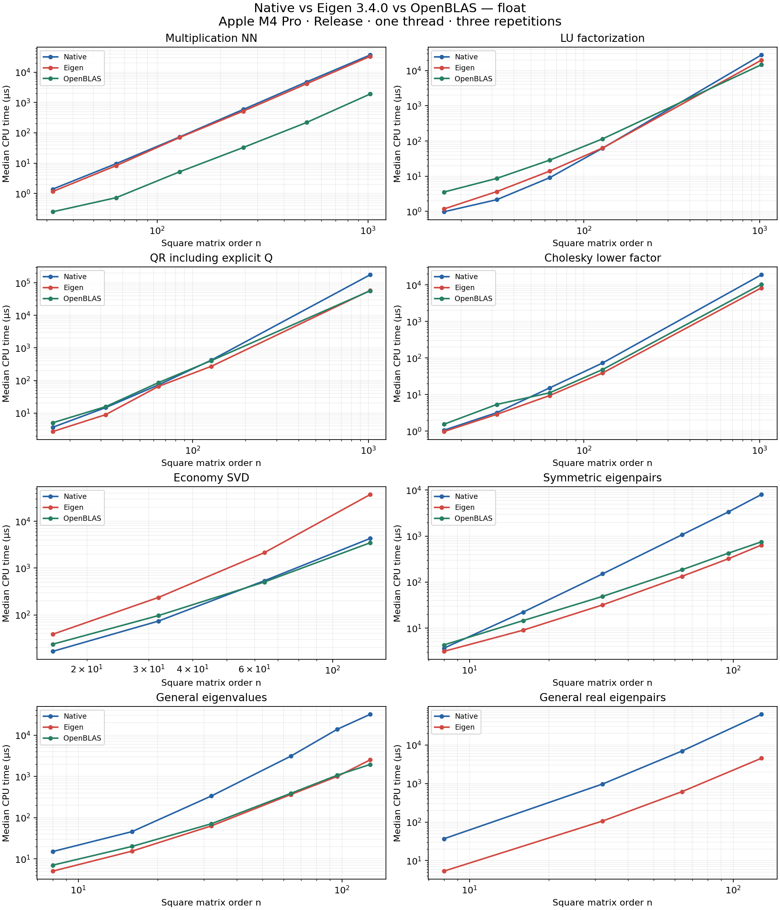
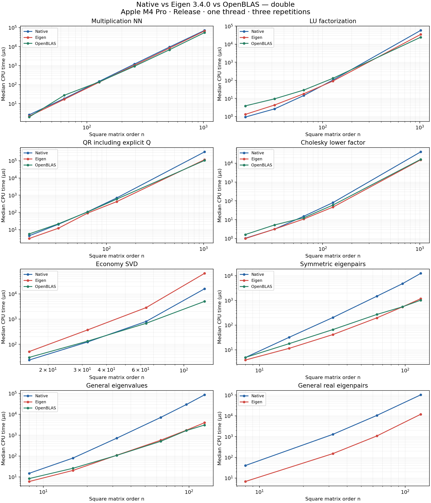

# Eigen comparison benchmark — 2026-10-23

Published artifacts include final CSV summaries, charts, and metadata. Raw benchmark JSON, run indexes, diagnostic logs, and intermediate measurements are generated locally and excluded from version control.

Model Name: MacBook Pro; Chip: Apple M4 Pro; Total Number of Cores: 14 (10 Performance and 4 Efficiency); Memory: 24 GB.

Release build, native SIMD enabled, Eigen 3.4.0, OpenBLAS/LAPACKE, C++17, LTO off. All backends use one thread. Cases run sequentially with the same inputs, 0.1 s minimum per repetition and three repetitions. Timings below are median CPU microseconds.

**Tests:** 91 GoogleTest cases passed, including 14 Eigen reference cases; the GPU source check also passed. See `tests.log` and `tests-detail.log.gz`.

**Benchmarks:** 322/322 cases completed successfully; 0 failed or timed out. 110 operation/scalar/shape combinations.

`Native / Eigen` is native time divided by Eigen time: above 1 means Eigen was faster; below 1 means native was faster. OpenBLAS uses the BLAS_LAPACKE backend. A dash means that backend has no registered result for this workload.

## Largest registered square sizes

### float

| Operation | Size | Native µs | Eigen µs | OpenBLAS µs | Native / Eigen |
|---|---:|---:|---:|---:|---:|
| Multiplication NN | 1024/1024/1024 | 36922.500 | 33177.500 | 1905.157 | 1.113 |
| Multiplication NT | 1024 | 36556.000 | 33590.000 | 27346.800 | 1.088 |
| Multiplication TN | 1024 | 36847.000 | 33688.250 | 27391.600 | 1.094 |
| Multiplication TT | 1024 | 36656.500 | 33876.500 | 27014.200 | 1.082 |
| LU factorization | 1024 | 27847.600 | 19814.714 | 14710.111 | 1.405 |
| QR including explicit Q | 1024 | 178480.000 | 58665.000 | 57402.500 | 3.042 |
| Cholesky lower factor | 1024 | 18887.143 | 8279.882 | 10339.462 | 2.281 |
| Economy SVD | 128 | 4304.594 | 37347.750 | 3478.800 | 0.115 |
| Symmetric eigenpairs | 128 | 8026.941 | 640.073 | 751.809 | 12.541 |
| General eigenvalues | 128 | 32036.250 | 2525.000 | 1952.338 | 12.688 |
| General real eigenpairs | 128 | 62287.000 | 4516.167 | — | 13.792 |

### double

| Operation | Size | Native µs | Eigen µs | OpenBLAS µs | Native / Eigen |
|---|---:|---:|---:|---:|---:|
| Multiplication NN | 1024/1024/1024 | 70875.500 | 65948.000 | 54190.000 | 1.075 |
| Multiplication NT | 1024 | 71521.000 | 66001.500 | 54061.667 | 1.084 |
| Multiplication TN | 1024 | 70797.500 | 65841.000 | 54327.000 | 1.075 |
| Multiplication TT | 1024 | 70921.500 | 65640.500 | 53621.000 | 1.080 |
| LU factorization | 1024 | 58171.500 | 34822.000 | 24368.800 | 1.671 |
| QR including explicit Q | 1024 | 327376.000 | 115374.000 | 103998.000 | 2.838 |
| Cholesky lower factor | 1024 | 40290.000 | 15231.444 | 16127.375 | 2.645 |
| Economy SVD | 128 | 15961.222 | 65524.000 | 5050.429 | 0.244 |
| Symmetric eigenpairs | 128 | 12424.364 | 1171.600 | 1024.022 | 10.605 |
| General eigenvalues | 128 | 85448.000 | 3952.714 | 3058.378 | 21.618 |
| General real eigenpairs | 128 | 102872.000 | 11910.364 | — | 8.637 |

## Scaling charts

Charts show median CPU time on logarithmic axes for square inputs. General eigenpair rows use the real-spectrum input and are compared separately from eigenvalues-only rows.





## Measurement details

- AppleClang compiler: `Apple clang version 21.0.0 (clang-2100.3.34.2)`.
- Build and dependency details, source hashes, and timestamps: [metadata.json](metadata.json).
- Every recorded timing: [timings.csv](timings.csv); aligned comparisons: [comparison.csv](comparison.csv).
- Exact commands and outcomes: `runs.json`; original Google Benchmark JSON and console logs: `raw/`.
- Eigen LU always uses partial pivoting; native LU pivoting is disabled in this build. The shared diagonally dominant input avoids swaps.
- QR includes explicit Q formation. SVD includes thin U and row-major VT; Eigen uses JacobiSVD, while the native and LAPACK paths use different algorithms.
- Input refresh is excluded from the timed region except for SVD. Reused objects avoid outer allocation, but internal backend work and copies are timed.
- The native SVD suite is capped at 128 in the existing benchmark. These results describe registered inputs on this machine; they do not establish performance for arbitrary matrices.
- Google Benchmark could not query CPU frequency or set thread affinity on this macOS host. Its estimated MHz metadata is ignored; timings come from measured clocks.
- Repetition variation is preserved in `cpu_cv_percent` in the timing CSV. Background activity, CPU scheduling and thermal state can affect measurements.

## Reproduce

```sh
cmake -S . -B build_eigen_compare -G Ninja -DCMAKE_BUILD_TYPE=Release \
  -DLINALG_ENABLE_BLAS=ON -DLINALG_ENABLE_BENCHMARK=ON -DLINALG_LTO_MODE=off
cmake --build build_eigen_compare --parallel 4
OPENBLAS_NUM_THREADS=1 MKL_NUM_THREADS=1 BLIS_NUM_THREADS=1 \
  ctest --test-dir build_eigen_compare -L Unit --output-on-failure
python3 Testing/Benchmark/run_eigen_comparison.py --build-dir build_eigen_compare \
  --output-dir /tmp/eigen-benchmark
python3 Testing/Benchmark/summarize_eigen_comparison.py /tmp/eigen-benchmark
```

The chart script requires Matplotlib. Eigen headers come from the pinned submodule.

## All measurements

### Multiplication NN

| Scalar / shape | Native µs | Eigen µs | OpenBLAS µs | Native / Eigen |
|---|---:|---:|---:|---:|
| double / 32/32/32 | 2.582 | 2.174 | 1.966 | 1.187 |
| double / 64/64/64 | 18.446 | 16.808 | 27.433 | 1.097 |
| double / 64/1024/256 | 1217.183 | 1111.850 | 974.160 | 1.095 |
| double / 128/128/128 | 148.768 | 134.598 | 139.467 | 1.105 |
| double / 256/256/256 | 1198.207 | 1042.185 | 917.216 | 1.150 |
| double / 512/512/512 | 9426.133 | 8248.294 | 6784.048 | 1.143 |
| double / 1024/64/256 | 1161.252 | 1083.570 | 1109.532 | 1.072 |
| double / 1024/1024/1024 | 70875.500 | 65948.000 | 54190.000 | 1.075 |
| float / 32/32/32 | 1.395 | 1.163 | 0.250 | 1.200 |
| float / 64/64/64 | 9.663 | 8.297 | 0.730 | 1.165 |
| float / 64/1024/256 | 696.218 | 551.378 | 37.056 | 1.263 |
| float / 128/128/128 | 73.248 | 70.282 | 5.209 | 1.042 |
| float / 256/256/256 | 588.702 | 518.870 | 32.822 | 1.135 |
| float / 512/512/512 | 4783.448 | 4160.706 | 220.219 | 1.150 |
| float / 1024/64/256 | 613.823 | 537.019 | 41.479 | 1.143 |
| float / 1024/1024/1024 | 36922.500 | 33177.500 | 1905.157 | 1.113 |

### Multiplication NT

| Scalar / shape | Native µs | Eigen µs | OpenBLAS µs | Native / Eigen |
|---|---:|---:|---:|---:|
| double / 64 | 17.940 | 16.872 | 27.146 | 1.063 |
| double / 256 | 1190.786 | 1035.744 | 915.474 | 1.150 |
| double / 512 | 9170.933 | 8331.235 | 6766.333 | 1.101 |
| double / 1024 | 71521.000 | 66001.500 | 54061.667 | 1.084 |
| float / 64 | 9.741 | 8.401 | 20.524 | 1.160 |
| float / 256 | 577.083 | 521.647 | 490.167 | 1.106 |
| float / 512 | 4774.900 | 4180.765 | 3497.700 | 1.142 |
| float / 1024 | 36556.000 | 33590.000 | 27346.800 | 1.088 |

### Multiplication TN

| Scalar / shape | Native µs | Eigen µs | OpenBLAS µs | Native / Eigen |
|---|---:|---:|---:|---:|
| double / 64 | 18.222 | 17.400 | 28.589 | 1.047 |
| double / 256 | 1200.595 | 1054.864 | 916.763 | 1.138 |
| double / 512 | 9334.067 | 8334.706 | 6800.857 | 1.120 |
| double / 1024 | 70797.500 | 65841.000 | 54327.000 | 1.075 |
| float / 64 | 9.536 | 8.429 | 19.824 | 1.131 |
| float / 256 | 589.515 | 526.859 | 493.452 | 1.119 |
| float / 512 | 4805.241 | 4167.118 | 3500.275 | 1.153 |
| float / 1024 | 36847.000 | 33688.250 | 27391.600 | 1.094 |

### Multiplication TT

| Scalar / shape | Native µs | Eigen µs | OpenBLAS µs | Native / Eigen |
|---|---:|---:|---:|---:|
| double / 64 | 17.859 | 17.165 | 27.451 | 1.040 |
| double / 256 | 1193.991 | 1045.466 | 925.053 | 1.142 |
| double / 512 | 9207.933 | 8243.647 | 6766.000 | 1.117 |
| double / 1024 | 70921.500 | 65640.500 | 53621.000 | 1.080 |
| float / 64 | 9.681 | 8.566 | 20.276 | 1.130 |
| float / 256 | 579.686 | 520.500 | 488.705 | 1.114 |
| float / 512 | 4761.759 | 4169.647 | 3495.975 | 1.142 |
| float / 1024 | 36656.500 | 33876.500 | 27014.200 | 1.082 |

### LU factorization

| Scalar / shape | Native µs | Eigen µs | OpenBLAS µs | Native / Eigen |
|---|---:|---:|---:|---:|
| double / 16 | 0.932 | 1.309 | 3.873 | 0.712 |
| double / 32 | 2.638 | 4.313 | 9.494 | 0.612 |
| double / 64 | 14.472 | 18.140 | 29.019 | 0.798 |
| double / 128 | 104.828 | 91.894 | 130.631 | 1.141 |
| double / 1024 | 58171.500 | 34822.000 | 24368.800 | 1.671 |
| float / 16 | 0.977 | 1.174 | 3.548 | 0.832 |
| float / 32 | 2.159 | 3.667 | 8.691 | 0.589 |
| float / 64 | 9.098 | 13.982 | 28.680 | 0.651 |
| float / 128 | 62.697 | 63.519 | 115.362 | 0.987 |
| float / 1024 | 27847.600 | 19814.714 | 14710.111 | 1.405 |

### QR including explicit Q

| Scalar / shape | Native µs | Eigen µs | OpenBLAS µs | Native / Eigen |
|---|---:|---:|---:|---:|
| double / 16 | 4.422 | 3.053 | 5.636 | 1.448 |
| double / 32 | 20.445 | 12.131 | 21.787 | 1.685 |
| double / 64 | 109.277 | 91.427 | 106.623 | 1.195 |
| double / 128 | 700.000 | 425.856 | 598.096 | 1.644 |
| double / 1024 | 327376.000 | 115374.000 | 103998.000 | 2.838 |
| float / 16 | 3.632 | 2.679 | 5.003 | 1.356 |
| float / 32 | 14.605 | 8.872 | 15.649 | 1.646 |
| float / 64 | 73.100 | 65.884 | 86.063 | 1.110 |
| float / 128 | 423.775 | 273.305 | 409.307 | 1.551 |
| float / 1024 | 178480.000 | 58665.000 | 57402.500 | 3.042 |

### Cholesky lower factor

| Scalar / shape | Native µs | Eigen µs | OpenBLAS µs | Native / Eigen |
|---|---:|---:|---:|---:|
| double / 16 | 1.029 | 0.989 | 1.611 | 1.040 |
| double / 32 | 3.126 | 3.127 | 5.226 | 1.000 |
| double / 64 | 15.139 | 10.821 | 12.599 | 1.399 |
| double / 128 | 80.919 | 46.685 | 59.924 | 1.733 |
| double / 1024 | 40290.000 | 15231.444 | 16127.375 | 2.645 |
| float / 16 | 1.064 | 0.978 | 1.546 | 1.089 |
| float / 32 | 3.216 | 2.893 | 5.393 | 1.111 |
| float / 64 | 15.314 | 9.455 | 11.229 | 1.620 |
| float / 128 | 73.302 | 39.112 | 48.527 | 1.874 |
| float / 1024 | 18887.143 | 8279.882 | 10339.462 | 2.281 |

### Economy SVD

| Scalar / shape | Native µs | Eigen µs | OpenBLAS µs | Native / Eigen |
|---|---:|---:|---:|---:|
| double / 16 | 23.628 | 51.158 | 30.077 | 0.462 |
| double / 32 | 123.375 | 371.355 | 132.845 | 0.332 |
| double / 64 | 804.954 | 2849.878 | 679.722 | 0.282 |
| double / 128 | 15961.222 | 65524.000 | 5050.429 | 0.244 |
| float / 16 | 16.599 | 38.504 | 23.585 | 0.431 |
| float / 32 | 73.745 | 236.242 | 96.740 | 0.312 |
| float / 64 | 536.398 | 2138.492 | 504.167 | 0.251 |
| float / 128 | 4304.594 | 37347.750 | 3478.800 | 0.115 |

### Symmetric eigenpairs

| Scalar / shape | Native µs | Eigen µs | OpenBLAS µs | Native / Eigen |
|---|---:|---:|---:|---:|
| double / 8 | 4.881 | 3.876 | 4.915 | 1.259 |
| double / 16 | 32.195 | 11.508 | 17.829 | 2.798 |
| double / 32 | 204.297 | 41.692 | 66.389 | 4.900 |
| double / 64 | 1481.189 | 196.720 | 270.490 | 7.529 |
| double / 96 | 4758.138 | 547.957 | 551.617 | 8.683 |
| double / 128 | 12424.364 | 1171.600 | 1024.022 | 10.605 |
| float / 8 | 3.665 | 3.127 | 4.315 | 1.172 |
| float / 16 | 22.387 | 9.048 | 14.617 | 2.474 |
| float / 32 | 151.645 | 32.011 | 49.044 | 4.737 |
| float / 64 | 1072.008 | 134.000 | 186.129 | 8.000 |
| float / 96 | 3372.634 | 322.708 | 427.320 | 10.451 |
| float / 128 | 8026.941 | 640.073 | 751.809 | 12.541 |

### General eigenvalues

| Scalar / shape | Native µs | Eigen µs | OpenBLAS µs | Native / Eigen |
|---|---:|---:|---:|---:|
| double / 8 | 14.780 | 5.976 | 8.288 | 2.473 |
| double / 16 | 79.678 | 20.362 | 25.784 | 3.913 |
| double / 32 | 719.062 | 109.037 | 107.443 | 6.595 |
| double / 64 | 7064.000 | 571.037 | 505.695 | 12.370 |
| double / 96 | 29306.000 | 1724.160 | 1655.553 | 16.997 |
| double / 128 | 85448.000 | 3952.714 | 3058.378 | 21.618 |
| float / 8 | 15.097 | 5.049 | 7.046 | 2.990 |
| float / 16 | 45.930 | 15.457 | 20.104 | 2.971 |
| float / 32 | 336.159 | 63.289 | 71.231 | 5.311 |
| float / 64 | 3102.636 | 363.703 | 388.612 | 8.531 |
| float / 96 | 13903.900 | 998.119 | 1069.869 | 13.930 |
| float / 128 | 32036.250 | 2525.000 | 1952.338 | 12.688 |

### General real eigenpairs

| Scalar / shape | Native µs | Eigen µs | OpenBLAS µs | Native / Eigen |
|---|---:|---:|---:|---:|
| double / 8 | 39.977 | 6.796 | — | 5.882 |
| double / 32 | 1287.574 | 151.505 | — | 8.499 |
| double / 64 | 10470.385 | 1070.893 | — | 9.777 |
| double / 128 | 102872.000 | 11910.364 | — | 8.637 |
| float / 8 | 36.850 | 5.331 | — | 6.913 |
| float / 32 | 971.972 | 106.620 | — | 9.116 |
| float / 64 | 6965.450 | 615.344 | — | 11.320 |
| float / 128 | 62287.000 | 4516.167 | — | 13.792 |
