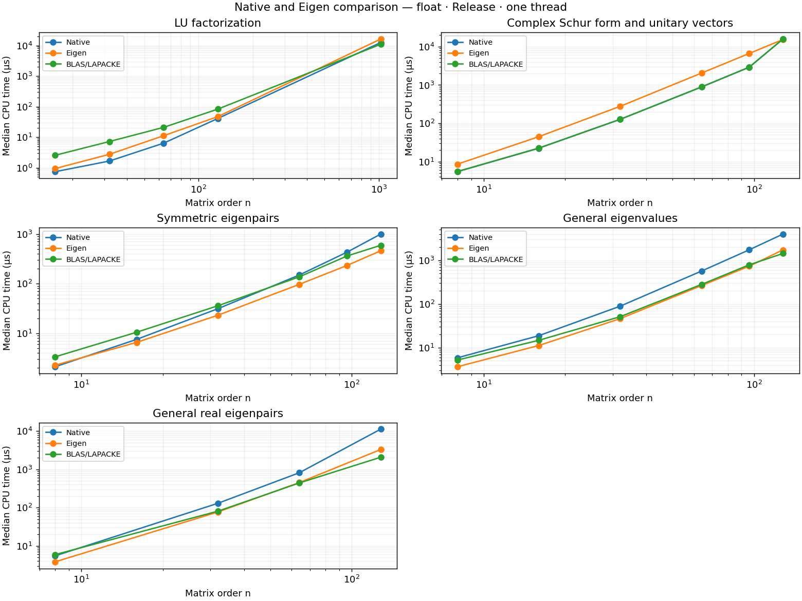
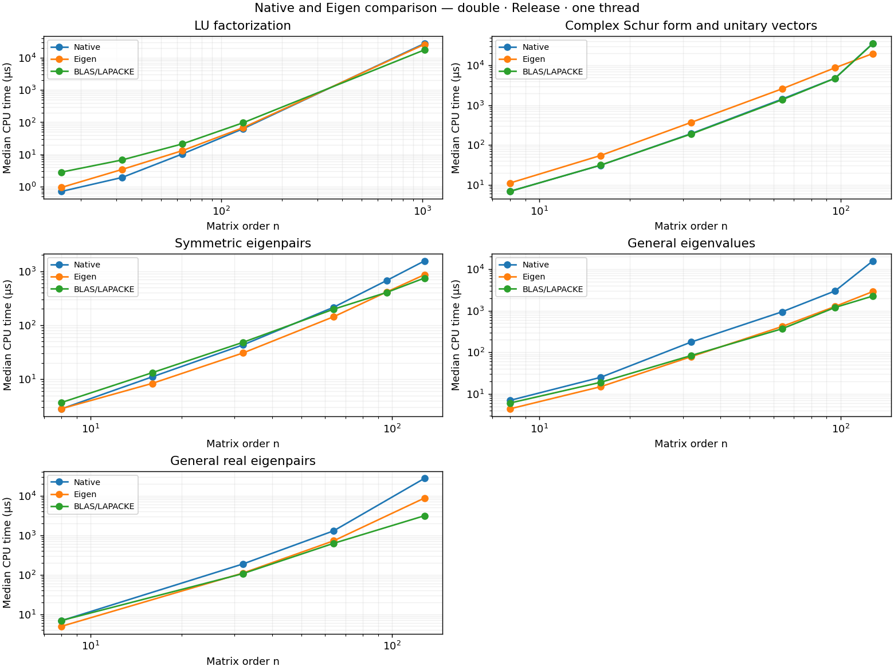

# Eigen comparison benchmark — 2026-10-24

Model Name: MacBook Pro; Chip: Apple M4 Pro; Total Number of Cores: 14 (10 Performance and 4 Efficiency); Memory: 24 GB

Release; SIMD=ON; ISA=neon; C++17; LTO=off. All backends use one thread. Cases run sequentially with three repetitions, at least 0.1 seconds per repetition. Timings are median CPU microseconds.

**Tests:** 99 GoogleTest cases passed. See [test output](tests.log) and [detailed test output](tests-detail.log.gz).

**Benchmarks:** 162/162 cases succeeded; 0 incomplete. 54 operation/scalar/shape combinations.

Native / Eigen is native time divided by Eigen time; values above 1 favor Eigen. A dash means no result was registered. BLAS/LAPACKE identifies the configured vendor library; norms use the shared CPU implementation for each CPU backend.

## Largest registered cases

### float

| Operation | Shape | Native µs | Eigen µs | BLAS/LAPACKE µs | Native / Eigen |
|---|---|---|---|---|---|
| LU factorization | 1024 | 12568.455 | 16342.111 | 11027.167 | 0.769 |
| Complex Schur form and unitary vectors | 128 | 15844.333 | 15406.111 | 15860.333 | 1.028 |
| Symmetric eigenpairs | 128 | 994.986 | 458.589 | 591.261 | 2.170 |
| General eigenvalues | 128 | 3995.314 | 1734.250 | 1435.750 | 2.304 |
| General real eigenpairs | 128 | 11313.917 | 3318.595 | 2082.667 | 3.409 |

### double

| Operation | Shape | Native µs | Eigen µs | BLAS/LAPACKE µs | Native / Eigen |
|---|---|---|---|---|---|
| LU factorization | 1024 | 27830.400 | 26136.400 | 17613.286 | 1.065 |
| Complex Schur form and unitary vectors | 128 | 35576.250 | 19871.286 | 35208.000 | 1.790 |
| Symmetric eigenpairs | 128 | 1547.035 | 860.090 | 746.043 | 1.799 |
| General eigenvalues | 128 | 15660.444 | 2878.854 | 2247.226 | 5.440 |
| General real eigenpairs | 128 | 27357.000 | 8688.000 | 3102.533 | 3.149 |

## Scaling

Square inputs; triangular solves fix the number of right-hand sides at 16.

## Measurement details

- Compiler: `Apple clang version 21.0.0 (clang-2100.3.34.2)`.
- Configuration, source hashes, timestamps, and thread settings: [metadata.json](metadata.json).
- All timings and variation: [timings.csv](timings.csv); aligned results: [comparison.csv](comparison.csv).
- Commands and outcomes: [runs.json](runs.json); original JSON and logs: [raw/](raw/).
- Measurement phases and source snapshots are recorded in metadata. When cases are repeated after a final change, their earlier measurements remain in `first-pass/`.
- Native LU pivoting: OFF. Eigen LU uses partial pivoting. The common diagonally dominant input avoids swaps.
- QR includes explicit Q formation. SVD includes thin U and row-major VT; algorithms differ by backend.
- Input refresh is untimed except for SVD. Outputs and workspaces are preallocated; internal backend allocations and copies remain timed.
- Factorized solves exclude LU factorization for every backend. Linear solve and inversion include factorization.
- Triangular solves include copying the right-hand side and use a non-unit diagonal. Transpose is in place for every backend.
- General eigenpairs use a real-spectrum input distinct from eigenvalues-only cases.
- Schur uses dense nonsymmetric real inputs, full complex triangular S and unitary Q, and split real/imaginary output planes. Eigen input promotion and output splitting are timed. Reconstruction, unitarity, and triangular form are checked before timing. Native and BLAS/MKL Schur currently share the portable algorithm.
- Native SVD registrations stop at 128. Results describe these inputs on this host; scheduling and thermal state can affect them.

## All measurements

### LU factorization

| Scalar / shape | Native µs | Eigen µs | BLAS/LAPACKE µs | Native / Eigen |
|---|---|---|---|---|
| double / 16 | 0.713 | 0.949 | 2.833 | 0.751 |
| double / 32 | 1.927 | 3.420 | 6.748 | 0.563 |
| double / 64 | 10.370 | 13.159 | 21.310 | 0.788 |
| double / 128 | 62.709 | 67.589 | 96.055 | 0.928 |
| double / 1024 | 27830.400 | 26136.400 | 17613.286 | 1.065 |
| float / 16 | 0.743 | 0.940 | 2.560 | 0.790 |
| float / 32 | 1.661 | 2.758 | 7.224 | 0.602 |
| float / 64 | 6.392 | 11.212 | 21.029 | 0.570 |
| float / 128 | 41.183 | 47.372 | 83.372 | 0.869 |
| float / 1024 | 12568.455 | 16342.111 | 11027.167 | 0.769 |

### Complex Schur form and unitary vectors

| Scalar / shape | Native µs | Eigen µs | BLAS/LAPACKE µs | Native / Eigen |
|---|---|---|---|---|
| double / 8 | 6.820 | 11.019 | 6.792 | 0.619 |
| double / 16 | 30.904 | 54.349 | 31.080 | 0.569 |
| double / 32 | 193.391 | 370.684 | 189.032 | 0.522 |
| double / 64 | 1423.990 | 2579.784 | 1366.437 | 0.552 |
| double / 96 | 4782.100 | 8740.500 | 4756.069 | 0.547 |
| double / 128 | 35576.250 | 19871.286 | 35208.000 | 1.790 |
| float / 8 | 5.446 | 8.566 | 5.517 | 0.636 |
| float / 16 | 22.368 | 44.768 | 22.517 | 0.500 |
| float / 32 | 126.900 | 277.580 | 126.817 | 0.457 |
| float / 64 | 886.481 | 2051.868 | 892.196 | 0.432 |
| float / 96 | 2910.063 | 6643.762 | 2915.167 | 0.438 |
| float / 128 | 15844.333 | 15406.111 | 15860.333 | 1.028 |

### Symmetric eigenpairs

| Scalar / shape | Native µs | Eigen µs | BLAS/LAPACKE µs | Native / Eigen |
|---|---|---|---|---|
| double / 8 | 2.822 | 2.844 | 3.700 | 0.992 |
| double / 16 | 11.047 | 8.355 | 13.193 | 1.322 |
| double / 32 | 43.109 | 30.550 | 48.148 | 1.411 |
| double / 64 | 215.083 | 143.563 | 197.966 | 1.498 |
| double / 96 | 673.438 | 412.508 | 404.646 | 1.633 |
| double / 128 | 1547.035 | 860.090 | 746.043 | 1.799 |
| float / 8 | 2.111 | 2.271 | 3.347 | 0.929 |
| float / 16 | 7.510 | 6.535 | 10.459 | 1.149 |
| float / 32 | 31.240 | 23.078 | 35.779 | 1.354 |
| float / 64 | 149.002 | 96.589 | 136.826 | 1.543 |
| float / 96 | 429.470 | 231.796 | 359.683 | 1.853 |
| float / 128 | 994.986 | 458.589 | 591.261 | 2.170 |

### General eigenvalues

| Scalar / shape | Native µs | Eigen µs | BLAS/LAPACKE µs | Native / Eigen |
|---|---|---|---|---|
| double / 8 | 6.979 | 4.378 | 6.033 | 1.594 |
| double / 16 | 25.019 | 14.904 | 19.022 | 1.679 |
| double / 32 | 177.046 | 78.851 | 83.856 | 2.245 |
| double / 64 | 939.500 | 416.304 | 367.196 | 2.257 |
| double / 96 | 2985.421 | 1265.074 | 1196.070 | 2.360 |
| double / 128 | 15660.444 | 2878.854 | 2247.226 | 5.440 |
| float / 8 | 5.832 | 3.642 | 5.181 | 1.601 |
| float / 16 | 18.754 | 11.180 | 14.712 | 1.678 |
| float / 32 | 89.024 | 46.159 | 51.097 | 1.929 |
| float / 64 | 568.322 | 264.238 | 280.667 | 2.151 |
| float / 96 | 1740.050 | 732.840 | 788.315 | 2.374 |
| float / 128 | 3995.314 | 1734.250 | 1435.750 | 2.304 |

### General real eigenpairs

| Scalar / shape | Native µs | Eigen µs | BLAS/LAPACKE µs | Native / Eigen |
|---|---|---|---|---|
| double / 8 | 6.851 | 4.938 | 6.934 | 1.387 |
| double / 32 | 186.845 | 109.887 | 106.503 | 1.700 |
| double / 64 | 1289.835 | 721.534 | 622.721 | 1.788 |
| double / 128 | 27357.000 | 8688.000 | 3102.533 | 3.149 |
| float / 8 | 5.487 | 3.827 | 5.905 | 1.434 |
| float / 32 | 130.026 | 76.989 | 80.813 | 1.689 |
| float / 64 | 818.688 | 453.180 | 442.509 | 1.807 |
| float / 128 | 11313.917 | 3318.595 | 2082.667 | 3.409 |
