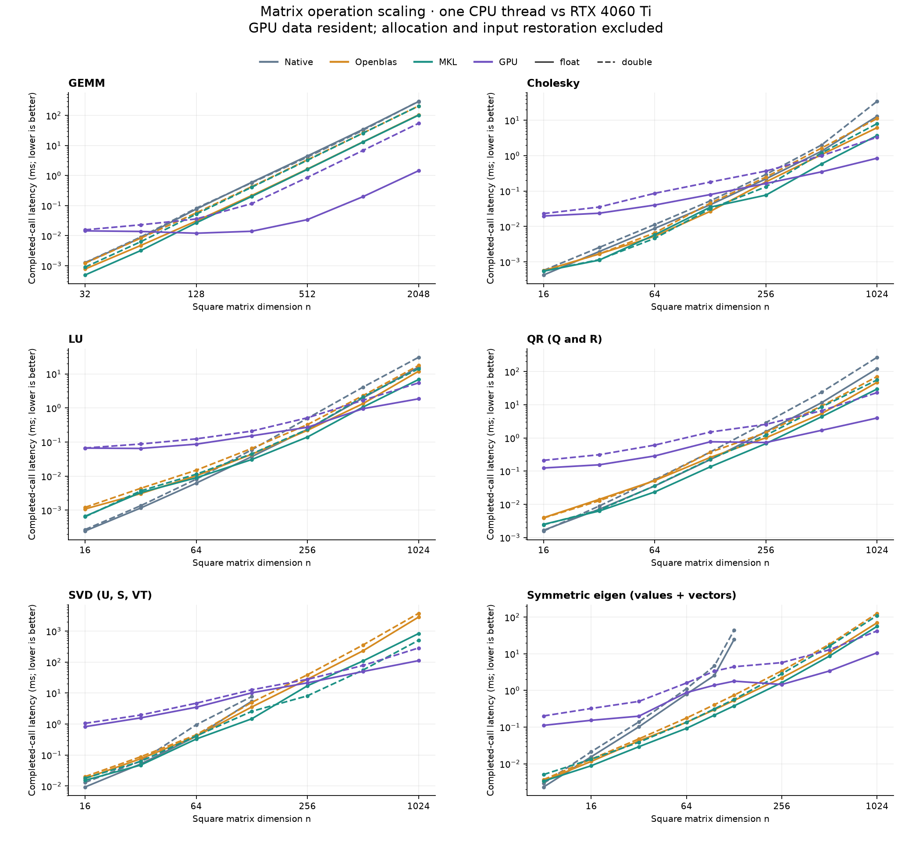
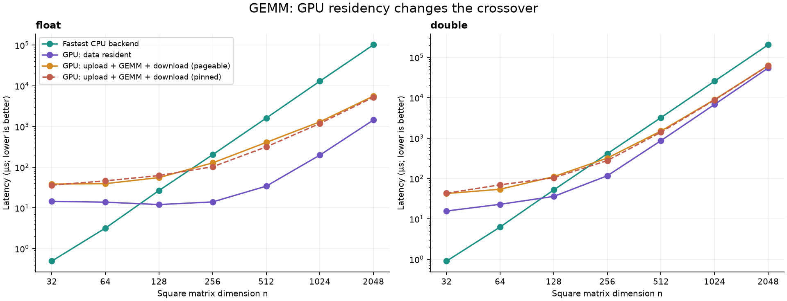

**Matrix operation benchmark analysis — 19 October 2026**

[Reproduction instructions](README.md) · [Recorded results](results/2026-10-19/final_results.csv) · [Environment metadata](results/2026-10-19/metadata.json)

The measured backends are the AVX2 native implementation, independently loaded OpenBLAS, Intel MKL and CUDA (cuBLAS/cuSOLVER). All four are called from the same analysis executable linked to the tested library. Large matrices generally favor the GPU under this single-thread CPU policy; small decompositions frequently favor a CPU backend. Precision and data transfers materially change the crossover.

**Measurement environment and scope**

| Component | Measured configuration |
| --- | --- |
| Date | 2026-10-19 |
| Library commit | 15534ab |
| Previous commit | c52ba9f |
| Cpu | Intel Core i9-14900K, 24 cores / 32 logical processors; affinity mask 0x1 |
| Os | Windows 11 Pro 10.0.26200 (build 26200) |
| Compiler | Clang 22.1.2, Release -O3, AVX2/FMA |
| Openblas | OpenBLAS 0.3.34 DYNAMIC_ARCH NO_AFFINITY Haswell MAX_THREADS=64; LP64 |
| Mkl | Intel oneMKL 2026.0.0, ILP64 |
| Gpu | NVIDIA GeForce RTX 4060 Ti, 8188 MiB, WDDM |
| Gpu driver | 591.86 |
| Cuda toolkit | 13.2.78 |

CTest applies PROCESSOR_AFFINITY=TRUE, PROCESSORS=1, MKL_NUM_THREADS=1 and OPENBLAS_NUM_THREADS=1. The harness affinity was observed as 0x1. This is a comparison against one CPU thread, not the full multicore capacity of the i9. The native backend is vectorized with AVX2/FMA; describing it as a purely scalar implementation would be inaccurate for this build.

The stock six benchmark executables currently register CPU cases only, even in a cuBLAS-enabled build. GPU results in this report come from the attached analysis harness, not from those stock registrations. The harness sources, this Markdown report, charts and recorded data live in examples/backend_benchmark alongside the repository include directory. Production library code is unchanged.

| Operation | Shapes / dimensions | Backend coverage |
| --- | --- | --- |
| GEMM, NN | Square 32–2048; 64×1024×256 and 1024×64×256 (M,N,K) | All four; float and double |
| GEMM, NT/TN/TT | Square 64, 256, 512, 1024 | All four; float and double |
| Cholesky, LU, QR | Square 16,32,64,128,256,512,1024 | All four; float and double |
| SVD | Square 16,32,64,128,256,512,1024 | All four through 128; vendor CPU + GPU above 128 |
| Symmetric eigen | Square 8,16,32,64,96,128,256,512,1024 | All four through 128; vendor CPU + GPU above 128 |
| General eigenvalues | Square 8,16,32,64,96,128 | Three CPU backends; no GPU implementation exposed |

This covers the operation families in the existing dense benchmark suite. It does not measure every library API: solves, inverse, determinant, norms, reductions, derivatives and batched operations are outside this run. General-eigenvector comparisons are also outside this harness; the stock suite's additional native eigenvector rows use a different constructed input and should not be mixed with eigenvalues-only results.

**Timing and inputs**

Completed-call wall time is measured with std::chrono::steady_clock. GPU calls run on a non-default, nonblocking stream and are followed by cudaStreamSynchronize inside the measured interval. Allocations, workspace queries, initial uploads and input restoration are outside that interval. Internal library copies, layout conversions, workspace queries performed by apply(), host API dispatch and completion waits remain included. Numerical status downloads occur after warm-up and timed repetition blocks, outside measured calls.

CPU inputs are restored before each call, outside timing. GPU Cholesky and LU restore their overwritten inputs with an untimed device-to-device copy and completion wait. The final read-only GPU measurements reuse resident inputs without unnecessary per-call restoration. All paths reuse allocated buffers. These are warm repeated-input measurements, not cold-cache or first-call/JIT measurements.

Matrices use fixed mt19937 seeds 42 (A) and 43 (B). GEMM/QR/SVD use uniform random values in [-1,1]. Cholesky uses a random symmetric, strictly diagonally dominant SPD matrix (diagonal shifted by 2n); LU and general eigen use random matrices with the same diagonal shift. Symmetric eigen uses a random symmetric matrix. Shapes and inputs match between backends within this harness. The Cholesky construction and untimed SVD restoration differ from the stock benchmarks, so the raw timings from the two harnesses should not be combined.

Initial cases used five repetitions, accumulating at least 50 ms of measured calls per repetition. Nineteen cases with >10% coefficient of variation (CV) were repeated with 200 ms warm-up and seven repetitions of at least 200 ms. The 88 read-only GPU cases were then measured with resident input reuse, 200 ms warm-up and seven repetitions of at least 100 ms. final_results.csv records the selected cohort, target duration and repetition count for every row; all earlier measurements are preserved. Each reported mean is the mean of per-repetition latency averages; median and sample standard deviation are also supplied. These CV values describe repetition stability, not confidence intervals for hardware-independent speedups.

There are **488 operation cases**, **64 transfer-only cases** and **32 directly measured upload–GEMM–download cases**. Final operation CV: median **1.50%**, maximum **9.76%**, cases over 10%: **0**. No numerical status failure or crash occurred. Success status and prior unit tests are not an exhaustive accuracy/conditioning study for every matrix size.

**Large matrices: mean latency in milliseconds, n=1024**

**float**

| Operation | Native | OpenBLAS | MKL | GPU | GPU speedup over best CPU |
| --- | --- | --- | --- | --- | --- |
| GEMM | 34.37 | 13.19 | 13.04 | 0.199 | 65.65× |
| Cholesky | 13.01 | 6.190 | 3.703 | 0.849 | 4.36× |
| LU | 15.86 | 11.96 | 6.823 | 1.853 | 3.68× |
| QR (Q and R) | 122.19 | 47.21 | 29.75 | 3.983 | 7.47× |
| SVD (U, S, VT) | Not measured | 2,839.30 | 834.95 | 111.47 | 7.49× |
| Symmetric eigen (values + vectors) | Not measured | 70.27 | 56.07 | 10.65 | 5.27× |

**double**

| Operation | Native | OpenBLAS | MKL | GPU | GPU speedup over best CPU |
| --- | --- | --- | --- | --- | --- |
| GEMM | 32.12 | 25.99 | 25.79 | 6.855 | 3.76× |
| Cholesky | 34.37 | 11.22 | 8.031 | 3.322 | 2.42× |
| LU | 30.61 | 17.65 | 14.14 | 5.440 | 2.60× |
| QR (Q and R) | 268.45 | 70.74 | 55.77 | 23.19 | 2.40× |
| SVD (U, S, VT) | Not measured | 3,751.49 | 505.61 | 286.31 | 1.77× |
| Symmetric eigen (values + vectors) | Not measured | 127.02 | 110.17 | 42.11 | 2.62× |

Native SVD and symmetric eigen were intentionally capped at 128 in this analysis. The stock SVD benchmark documents a pre-existing convergence/runtime issue at larger native sizes; the eigen cap follows its stock benchmark range. Missing native rows above that cap are not failures or zero-time results. General eigen is reported separately at 128 because larger cases were not in this comparison's scope.

**Smaller matrices: mean latency in microseconds, n=128**

**float**

| Operation | Native | OpenBLAS | MKL | GPU | GPU speedup over best CPU |
| --- | --- | --- | --- | --- | --- |
| GEMM | 76.78 | 30.72 | 26.82 | 12.09 | 2.22× |
| Cholesky | 41.26 | 26.87 | 35.33 | 79.98 | 0.34× |
| LU | 37.36 | 43.87 | 30.71 | 152.21 | 0.20× |
| QR (Q and R) | 222.53 | 259.51 | 135.08 | 765.93 | 0.18× |
| SVD (U, S, VT) | 5,478.71 | 3,568.51 | 1,483.24 | 10,210.12 | 0.15× |
| Symmetric eigen (values + vectors) | 24,794.04 | 534.45 | 380.21 | 1,793.28 | 0.21× |
| General eigen (values only) | 22,880.45 | 1,522.83 | 1,380.84 | Not measured | Unsupported |

**double**

| Operation | Native | OpenBLAS | MKL | GPU | GPU speedup over best CPU |
| --- | --- | --- | --- | --- | --- |
| GEMM | 82.19 | 57.52 | 52.13 | 36.01 | 1.45× |
| Cholesky | 53.06 | 45.76 | 31.85 | 180.23 | 0.18× |
| LU | 59.37 | 65.18 | 45.18 | 209.38 | 0.22× |
| QR (Q and R) | 376.83 | 371.14 | 228.12 | 1,506.42 | 0.15× |
| SVD (U, S, VT) | 7,742.52 | 5,030.49 | 2,579.39 | 12,790.89 | 0.20× |
| Symmetric eigen (values + vectors) | 44,430.08 | 743.73 | 571.77 | 4,433.12 | 0.13× |
| General eigen (values only) | 42,669.06 | 2,444.70 | 2,279.15 | Not measured | Unsupported |

**Observed crossover and per-operation interpretation**

| Operation | First sustained GPU win: float n | First sustained GPU win: double n |
| --- | --- | --- |
| GEMM | 128 | 128 |
| Cholesky | 512 | 512 |
| LU | 512 | 512 |
| QR (Q and R) | 512 | 512 |
| SVD (U, S, VT) | 512 | 1024 |
| Symmetric eigen (values + vectors) | 256 | 512 |

A crossover is the first sampled square size where GPU latency beats the fastest measured CPU backend and stays ahead at all larger sampled sizes. It is not an exact threshold between samples, does not apply to every input or shape, and is for data-resident GPU calls. Comparisons near parity should be rechecked on the intended workload.

GEMM has the strongest large-matrix GPU scaling, especially in float. MKL and OpenBLAS become close for large CPU GEMM, so preserving independent providers is useful even when one wins by only a few percent. GPU transpose flags are passed through cuBLAS with swapped row-major operands, without the library explicitly materializing transposes. The complete rectangular and transpose rows are included below rather than folded into the square results.

Cholesky and LU have much larger GPU overhead relative to tiny CPU factorizations. Native wins several tiny LU cases, but native LU was built with optional pivoting OFF while OpenBLAS, MKL and cuSOLVER use pivoted GETRF. Those small-LU results are not identical algorithm contracts. The strongly diagonally dominant input also avoids difficult pivoting behavior. MKL generally leads the larger CPU decomposition cases, with some size-specific OpenBLAS wins in Cholesky.

QR returns explicit Q and R. Its GPU path includes layout conversion, GEQRF, ORGQR and clearing R's lower triangle, so these timings should not be compared with a factorization-only GEQRF result. GPU QR's substantial workspace is a separate cost, shown below. Native QR becomes expensive with size; large vendor CPU and GPU paths offer substantially better latency in this run.

SVD computes singular vectors as well as singular values. Small cases favor CPU. MKL is substantially faster than OpenBLAS on larger SVD cases in this installation, and float/double timings do not follow a simple universal ratio. Both CPU adapters call GESVD, so this result is not evidence of a GESDD-versus-GESVD API mismatch. Backend implementations and convergence behavior differ; assigning a precise cause needs profiling. GPU's double-precision crossover is later than its float crossover.

Symmetric eigen includes eigenvectors. The native implementation is much slower than vendor CPU libraries near the upper end of its measured range. GPU becomes attractive at larger sizes; general nonsymmetric eigen remains a CPU choice because this library does not expose that GPU specialization.

The GPU's float and double GEMM performance differ far more than the CPU's in this run. Treat precision as part of backend selection. NVIDIA's [native arithmetic throughput table](https://docs.nvidia.com/cuda/archive/12.9.1/cuda-c-programming-guide/index.html#arithmetic-instructions) documents architecture-dependent FP32/FP64 throughput; the measured result here should not be generalized to a GPU designed for high FP64 throughput. GPU clocks, driver scheduling and vendor algorithm selection can also make small-size curves nonmonotonic; this run does not isolate each cause.

**Transfers and directly measured end-to-end GEMM**

| Precision | n | Best CPU µs | GPU resident µs | GPU E2E pageable µs | GPU E2E pinned µs |
| --- | --- | --- | --- | --- | --- |
| float | 64 | 3.194 | 13.84 | 39.43 | 46.29 |
| float | 128 | 26.82 | 12.09 | 55.73 | 62.52 |
| float | 256 | 203.14 | 14.05 | 127.79 | 102.64 |
| float | 512 | 1,612.00 | 34.22 | 407.06 | 316.08 |
| float | 1024 | 13,039.51 | 198.63 | 1,306.46 | 1,187.50 |
| float | 2048 | 102,015.00 | 1,450.24 | 5,599.79 | 5,258.91 |
| double | 64 | 6.288 | 23.00 | 54.24 | 69.85 |
| double | 128 | 52.13 | 36.01 | 111.25 | 104.38 |
| double | 256 | 411.58 | 117.06 | 320.98 | 278.95 |
| double | 512 | 3,230.42 | 868.37 | 1,503.92 | 1,402.39 |
| double | 1024 | 25,789.22 | 6,854.91 | 9,017.08 | 8,814.64 |
| double | 2048 | 205,650.46 | 54,681.31 | 63,066.60 | 62,562.30 |

End-to-end GEMM directly times two host-to-device uploads, the library GEMM, one device-to-host result download and a final stream wait. Input/output and device buffers are preallocated. It is a separate measured flow, not a sum of independent transfer and compute timings. Pageable and cudaMallocHost-pinned host memory are both measured; pinned allocation cost is excluded. Transfers are serial in one stream, with no overlap or batching. Small-case driver behavior can differ between this sequence and an isolated resident call, so costs are not strictly additive.

Moving a result to the CPU after every operation can erase the advantage of a small GPU call. Keeping a chain of operations on-device avoids repeated transfers. NVIDIA recommends reducing host/device traffic and explains pinned-memory and overlap tradeoffs in its [CUDA Best Practices Guide](https://docs.nvidia.com/cuda/cuda-c-best-practices-guide/index.html#data-transfer-between-host-and-device). The full transfer-only measurements, including one-upload/one-download and two-upload/one-download flows, are in transfers.csv. End-to-end decomposition transfers were not measured, so no transfer-inclusive decomposition crossover is claimed.

**Caller-owned workspace at n=1024, MiB**

| Precision | Operation | Native | OpenBLAS | MKL | GPU |
| --- | --- | --- | --- | --- | --- |
| float | GEMM | 2.688 | 0.000 | 0.000 | 0.000 |
| float | Cholesky | 0.000 | 0.000 | 0.000 | 0.000 |
| float | LU | 0.000 | 0.004 | 0.000 | 4.012 |
| float | QR (Q and R) | 8.012 | 4.129 | 4.258 | 209.567 |
| float | SVD (U, S, VT) | Not measured | 0.262 | 0.262 | 29.271 |
| float | Symmetric eigen (values + vectors) | Not measured | 4.000 | 4.000 | 24.622 |
| double | GEMM | 5.375 | 0.000 | 0.000 | 0.000 |
| double | Cholesky | 0.000 | 0.000 | 0.000 | 0.000 |
| double | LU | 0.000 | 0.004 | 0.000 | 8.012 |
| double | QR (Q and R) | 16.023 | 8.258 | 8.516 | 419.135 |
| double | SVD (U, S, VT) | Not measured | 0.523 | 0.523 | 58.541 |
| double | Symmetric eigen (values + vectors) | Not measured | 8.000 | 8.000 | 49.244 |

These are public workspace_size() results only. Input/output buffers, retained handles, vendor internal allocations and total peak VRAM are not included. In particular, GPU QR requests roughly 210 MiB in float and 419 MiB in double for a 1024 square matrix, despite an input of only 4 or 8 MiB. Plan memory capacity using the actual query, not just matrix storage. A small or zero caller workspace does not prove zero internal vendor memory use.

**Practical choices supported by this run**

Use native when its small-case latency and algorithm contract fit; tiny LU is an example, subject to the pivoting difference. Use a vendor CPU backend for small and medium factorizations and for general eigen. MKL is a strong CPU choice in this installation, but retain OpenBLAS as a distinct selectable provider and use measured operation/size data. Use the GPU for sufficiently large resident matrices, with separate float/double policies. For host-resident GEMM, consult the directly measured transfer-inclusive rows. Avoid one unconditional threshold for every operation.

The next performance work should target real application sizes and residency patterns, then CPU thread scaling, batched small matrices and GPU memory reuse. Repeated workspace/layout queries and conversions visible in the current GPU adapters are profiling candidates; these measurements alone do not establish how much speedup removing them would deliver. Any multicore CPU comparison needs a deliberate new affinity/thread policy and separate stability validation because this report uses the validated one-core workaround.

**Validation, limits and reproduction**

At library commit 15534ab, python setup.py build.test.blas.cublas.mkl.benchmark passed all eight CTest entries: 92 unit tests (including 21 GPU tests and two provider-isolation tests), the GPU source-residency check and six stock CPU benchmark executables. QR and SVD then each passed 10/10 additional full CTest runs. The analysis harness's 488 cases, focused longer-sample runs, steady-input GPU runs and 96 transfer/E2E cases also completed successfully. This supports the current stability workaround on this host; it does not identify or permanently repair the underlying unpinned crash.

This is one host, one compiler/library set, fixed random seeds, warm inputs, one CPU thread, no locked CPU/GPU clocks and Windows WDDM scheduling. Cases run in a fixed native/OpenBLAS/MKL/GPU order, not randomized across backend processes. Five or seven repetition averages do not establish universal statistical significance. No power/energy, cold-start, concurrent-stream, batched, full multicore, ill-conditioned-input or exhaustive numerical-accuracy study was performed.

Clang itself access-violated once while building the harness, and Python access-violated once while preparing plot dependencies. Both preparatory operations succeeded when pinned to one CPU. No measured benchmark failure followed. This is further reason to describe affinity as a validated workaround rather than a proven diagnosis of an MKL-specific bug.

Build the example from the repository root with LINALG_BUILD_EXAMPLES=ON and the BLAS, LAPACKE, MKL and cuBLAS backends enabled. CMake links LinearAlgebra::LinearAlgebra directly; no path to a prebuilt import library is embedded in the example. The README describes configuration, CTest commands and Markdown regeneration. New runtime CSV files go to the example build directory; the dated recorded data remain under results/2026-10-19. This four-backend CUDA example currently uses CMake; the repository Bazel integration supports CPU sources only.

**Complete operation measurements**

All times below are mean completed-call latency in microseconds. Shapes are M×N×K; transpose flags are (A,B). The CSV also contains medians, sample standard deviations, measured iteration counts and sampling provenance.

**GEMM**

| Precision | Shape | Transpose | Native µs | OpenBLAS µs | MKL µs | GPU µs |
| --- | --- | --- | --- | --- | --- | --- |
| float | 32×32×32 | 0,0 | 1.248 | 0.779 | 0.493 | 14.49 |
| float | 64×64×64 | 0,0 | 8.440 | 4.721 | 3.194 | 13.84 |
| float | 64×64×64 | 0,1 | 8.409 | 4.745 | 4.049 | 13.79 |
| float | 64×64×64 | 1,0 | 8.120 | 4.889 | 3.206 | 13.94 |
| float | 64×64×64 | 1,1 | 8.226 | 4.959 | 3.812 | 13.39 |
| float | 64×1024×256 | 0,0 | 518.52 | 269.92 | 197.50 | 14.59 |
| float | 128×128×128 | 0,0 | 76.78 | 30.72 | 26.82 | 12.09 |
| float | 256×256×256 | 0,0 | 600.66 | 217.44 | 203.14 | 14.05 |
| float | 256×256×256 | 0,1 | 618.82 | 218.75 | 206.06 | 13.94 |
| float | 256×256×256 | 1,0 | 600.23 | 223.99 | 205.31 | 15.46 |
| float | 256×256×256 | 1,1 | 629.73 | 222.50 | 207.34 | 15.28 |
| float | 512×512×512 | 0,0 | 4,478.56 | 1,648.77 | 1,612.00 | 34.22 |
| float | 512×512×512 | 0,1 | 4,527.84 | 1,660.04 | 1,609.84 | 37.07 |
| float | 512×512×512 | 1,0 | 4,712.55 | 1,725.36 | 1,613.38 | 36.65 |
| float | 512×512×512 | 1,1 | 4,525.83 | 1,693.58 | 1,644.52 | 33.99 |
| float | 1024×64×256 | 0,0 | 546.91 | 224.67 | 196.66 | 14.38 |
| float | 1024×1024×1024 | 0,0 | 34,369.61 | 13,190.66 | 13,039.51 | 198.63 |
| float | 1024×1024×1024 | 0,1 | 34,589.75 | 13,304.51 | 12,900.92 | 212.21 |
| float | 1024×1024×1024 | 1,0 | 34,598.56 | 13,192.86 | 13,150.45 | 192.49 |
| float | 1024×1024×1024 | 1,1 | 34,505.98 | 13,242.26 | 13,897.03 | 204.03 |
| float | 2048×2048×2048 | 0,0 | 289,962.06 | 104,368.40 | 102,015.00 | 1,450.24 |
| double | 32×32×32 | 0,0 | 1.278 | 1.214 | 0.900 | 15.67 |
| double | 64×64×64 | 0,0 | 9.015 | 8.282 | 6.288 | 23.00 |
| double | 64×64×64 | 0,1 | 8.966 | 8.136 | 7.162 | 22.39 |
| double | 64×64×64 | 1,0 | 8.904 | 9.034 | 6.515 | 22.30 |
| double | 64×64×64 | 1,1 | 8.821 | 8.690 | 7.275 | 22.43 |
| double | 64×1024×256 | 0,0 | 558.32 | 480.53 | 413.24 | 121.91 |
| double | 128×128×128 | 0,0 | 82.19 | 57.52 | 52.13 | 36.01 |
| double | 256×256×256 | 0,0 | 577.68 | 429.24 | 411.58 | 117.06 |
| double | 256×256×256 | 0,1 | 572.70 | 428.28 | 413.66 | 118.74 |
| double | 256×256×256 | 1,0 | 573.38 | 436.68 | 413.34 | 116.31 |
| double | 256×256×256 | 1,1 | 571.64 | 438.16 | 413.44 | 116.95 |
| double | 512×512×512 | 0,0 | 4,115.75 | 3,350.60 | 3,230.42 | 868.37 |
| double | 512×512×512 | 0,1 | 4,106.36 | 3,375.03 | 3,248.11 | 876.57 |
| double | 512×512×512 | 1,0 | 4,146.47 | 3,376.03 | 3,325.28 | 866.74 |
| double | 512×512×512 | 1,1 | 4,178.09 | 3,423.59 | 3,340.88 | 866.88 |
| double | 1024×64×256 | 0,0 | 553.24 | 512.24 | 442.38 | 118.41 |
| double | 1024×1024×1024 | 0,0 | 32,117.04 | 25,992.06 | 25,789.22 | 6,854.91 |
| double | 1024×1024×1024 | 0,1 | 31,335.37 | 26,015.74 | 25,818.35 | 6,683.27 |
| double | 1024×1024×1024 | 1,0 | 33,444.46 | 26,390.99 | 26,412.65 | 6,855.62 |
| double | 1024×1024×1024 | 1,1 | 32,181.40 | 26,571.15 | 25,723.86 | 6,858.05 |
| double | 2048×2048×2048 | 0,0 | 295,347.92 | 206,380.54 | 205,650.46 | 54,681.31 |

**Cholesky**

| Precision | Shape | Transpose | Native µs | OpenBLAS µs | MKL µs | GPU µs |
| --- | --- | --- | --- | --- | --- | --- |
| float | 16×16×16 | 0,0 | 0.427 | 0.565 | 0.547 | 19.80 |
| float | 32×32×32 | 0,0 | 1.959 | 1.679 | 1.123 | 23.73 |
| float | 64×64×64 | 0,0 | 8.869 | 5.312 | 5.826 | 40.32 |
| float | 128×128×128 | 0,0 | 41.26 | 26.87 | 35.33 | 79.98 |
| float | 256×256×256 | 0,0 | 221.73 | 182.44 | 76.95 | 164.29 |
| float | 512×512×512 | 0,0 | 1,339.66 | 1,069.24 | 584.89 | 350.12 |
| float | 1024×1024×1024 | 0,0 | 13,007.69 | 6,189.83 | 3,703.08 | 848.65 |
| double | 16×16×16 | 0,0 | 0.576 | 0.564 | 0.554 | 23.17 |
| double | 32×32×32 | 0,0 | 2.559 | 1.681 | 1.155 | 35.43 |
| double | 64×64×64 | 0,0 | 11.39 | 6.616 | 4.630 | 86.72 |
| double | 128×128×128 | 0,0 | 53.06 | 45.76 | 31.85 | 180.23 |
| double | 256×256×256 | 0,0 | 295.74 | 248.89 | 132.28 | 368.55 |
| double | 512×512×512 | 0,0 | 2,004.19 | 1,640.59 | 1,197.08 | 997.98 |
| double | 1024×1024×1024 | 0,0 | 34,371.70 | 11,218.95 | 8,031.09 | 3,321.57 |

**LU**

| Precision | Shape | Transpose | Native µs | OpenBLAS µs | MKL µs | GPU µs |
| --- | --- | --- | --- | --- | --- | --- |
| float | 16×16×16 | 0,0 | 0.245 | 1.086 | 0.664 | 66.36 |
| float | 32×32×32 | 0,0 | 1.159 | 3.062 | 3.298 | 64.90 |
| float | 64×64×64 | 0,0 | 6.231 | 10.25 | 8.938 | 86.57 |
| float | 128×128×128 | 0,0 | 37.36 | 43.87 | 30.71 | 152.21 |
| float | 256×256×256 | 0,0 | 235.35 | 220.47 | 140.03 | 270.79 |
| float | 512×512×512 | 0,0 | 1,973.13 | 1,338.11 | 1,060.22 | 949.86 |
| float | 1024×1024×1024 | 0,0 | 15,861.44 | 11,958.08 | 6,823.36 | 1,853.05 |
| double | 16×16×16 | 0,0 | 0.270 | 1.210 | 0.642 | 66.72 |
| double | 32×32×32 | 0,0 | 1.355 | 4.378 | 3.684 | 87.55 |
| double | 64×64×64 | 0,0 | 8.151 | 14.91 | 11.36 | 124.10 |
| double | 128×128×128 | 0,0 | 59.37 | 65.18 | 45.18 | 209.38 |
| double | 256×256×256 | 0,0 | 495.93 | 324.04 | 234.45 | 514.38 |
| double | 512×512×512 | 0,0 | 4,080.80 | 2,302.02 | 2,099.88 | 1,679.19 |
| double | 1024×1024×1024 | 0,0 | 30,611.16 | 17,646.77 | 14,140.85 | 5,440.40 |

**QR (Q and R)**

| Precision | Shape | Transpose | Native µs | OpenBLAS µs | MKL µs | GPU µs |
| --- | --- | --- | --- | --- | --- | --- |
| float | 16×16×16 | 0,0 | 1.656 | 3.952 | 2.489 | 124.28 |
| float | 32×32×32 | 0,0 | 7.085 | 14.08 | 6.277 | 154.82 |
| float | 64×64×64 | 0,0 | 35.77 | 51.89 | 23.59 | 286.72 |
| float | 128×128×128 | 0,0 | 222.53 | 259.51 | 135.08 | 765.93 |
| float | 256×256×256 | 0,0 | 1,549.76 | 1,009.15 | 675.55 | 727.64 |
| float | 512×512×512 | 0,0 | 11,500.09 | 5,380.77 | 4,338.42 | 1,694.06 |
| float | 1024×1024×1024 | 0,0 | 122,189.40 | 47,208.85 | 29,750.99 | 3,983.01 |
| double | 16×16×16 | 0,0 | 1.570 | 3.868 | 2.421 | 211.32 |
| double | 32×32×32 | 0,0 | 8.883 | 12.79 | 6.708 | 311.75 |
| double | 64×64×64 | 0,0 | 55.09 | 51.80 | 36.30 | 608.55 |
| double | 128×128×128 | 0,0 | 376.83 | 371.14 | 228.12 | 1,506.42 |
| double | 256×256×256 | 0,0 | 2,903.19 | 1,455.59 | 1,205.31 | 2,566.62 |
| double | 512×512×512 | 0,0 | 23,776.87 | 9,118.22 | 8,593.61 | 6,584.26 |
| double | 1024×1024×1024 | 0,0 | 268,450.78 | 70,739.62 | 55,771.38 | 23,191.97 |

**SVD (U, S, VT)**

| Precision | Shape | Transpose | Native µs | OpenBLAS µs | MKL µs | GPU µs |
| --- | --- | --- | --- | --- | --- | --- |
| float | 16×16×16 | 0,0 | 9.317 | 17.54 | 15.27 | 824.12 |
| float | 32×32×32 | 0,0 | 51.47 | 76.03 | 47.47 | 1,582.65 |
| float | 64×64×64 | 0,0 | 402.93 | 404.10 | 329.29 | 3,497.91 |
| float | 128×128×128 | 0,0 | 5,478.71 | 3,568.51 | 1,483.24 | 10,210.12 |
| float | 256×256×256 | 0,0 | — | 27,896.54 | 17,183.32 | 21,409.71 |
| float | 512×512×512 | 0,0 | — | 231,287.18 | 108,498.32 | 49,652.47 |
| float | 1024×1024×1024 | 0,0 | — | 2,839,300.44 | 834,949.60 | 111,469.39 |
| double | 16×16×16 | 0,0 | 13.07 | 20.17 | 17.96 | 1,059.23 |
| double | 32×32×32 | 0,0 | 63.85 | 88.08 | 62.20 | 1,959.29 |
| double | 64×64×64 | 0,0 | 951.15 | 450.71 | 414.02 | 4,716.25 |
| double | 128×128×128 | 0,0 | 7,742.52 | 5,030.49 | 2,579.39 | 12,790.89 |
| double | 256×256×256 | 0,0 | — | 38,988.48 | 8,161.81 | 27,733.40 |
| double | 512×512×512 | 0,0 | — | 356,440.42 | 55,334.36 | 77,925.54 |
| double | 1024×1024×1024 | 0,0 | — | 3,751,494.04 | 505,609.92 | 286,306.86 |

**Symmetric eigen (values + vectors)**

| Precision | Shape | Transpose | Native µs | OpenBLAS µs | MKL µs | GPU µs |
| --- | --- | --- | --- | --- | --- | --- |
| float | 8×8×8 | 0,0 | 2.322 | 3.384 | 3.359 | 111.54 |
| float | 16×16×16 | 0,0 | 15.54 | 11.60 | 8.845 | 153.36 |
| float | 32×32×32 | 0,0 | 101.91 | 42.09 | 29.19 | 198.79 |
| float | 64×64×64 | 0,0 | 794.04 | 135.05 | 92.60 | 878.09 |
| float | 96×96×96 | 0,0 | 2,571.01 | 298.22 | 211.89 | 1,389.22 |
| float | 128×128×128 | 0,0 | 24,794.04 | 534.45 | 380.21 | 1,793.28 |
| float | 256×256×256 | 0,0 | — | 2,210.06 | 1,636.30 | 1,452.88 |
| float | 512×512×512 | 0,0 | — | 10,733.27 | 8,661.96 | 3,401.59 |
| float | 1024×1024×1024 | 0,0 | — | 70,267.04 | 56,068.42 | 10,649.25 |
| double | 8×8×8 | 0,0 | 2.925 | 3.697 | 5.073 | 201.67 |
| double | 16×16×16 | 0,0 | 21.26 | 13.33 | 13.33 | 322.48 |
| double | 32×32×32 | 0,0 | 138.63 | 47.74 | 38.64 | 502.98 |
| double | 64×64×64 | 0,0 | 1,112.55 | 176.92 | 135.90 | 1,599.60 |
| double | 96×96×96 | 0,0 | 4,670.71 | 409.35 | 313.20 | 3,359.30 |
| double | 128×128×128 | 0,0 | 44,430.08 | 743.73 | 571.77 | 4,433.12 |
| double | 256×256×256 | 0,0 | — | 3,436.10 | 2,844.14 | 5,741.42 |
| double | 512×512×512 | 0,0 | — | 18,113.32 | 16,267.85 | 12,848.38 |
| double | 1024×1024×1024 | 0,0 | — | 127,023.58 | 110,168.32 | 42,105.61 |

**General eigen (values only)**

| Precision | Shape | Transpose | Native µs | OpenBLAS µs | MKL µs | GPU µs |
| --- | --- | --- | --- | --- | --- | --- |
| float | 8×8×8 | 0,0 | 11.38 | 4.704 | 5.511 | — |
| float | 16×16×16 | 0,0 | 31.59 | 15.33 | 15.16 | — |
| float | 32×32×32 | 0,0 | 212.30 | 55.73 | 45.81 | — |
| float | 64×64×64 | 0,0 | 2,045.71 | 256.77 | 241.60 | — |
| float | 96×96×96 | 0,0 | 9,250.22 | 864.03 | 841.80 | — |
| float | 128×128×128 | 0,0 | 22,880.45 | 1,522.83 | 1,380.84 | — |
| double | 8×8×8 | 0,0 | 10.29 | 5.388 | 3.740 | — |
| double | 16×16×16 | 0,0 | 43.20 | 17.39 | 11.75 | — |
| double | 32×32×32 | 0,0 | 367.20 | 73.66 | 52.66 | — |
| double | 64×64×64 | 0,0 | 3,645.09 | 358.96 | 266.97 | — |
| double | 96×96×96 | 0,0 | 14,880.66 | 1,238.00 | 724.00 | — |
| double | 128×128×128 | 0,0 | 42,669.06 | 2,444.70 | 2,279.15 | — |
